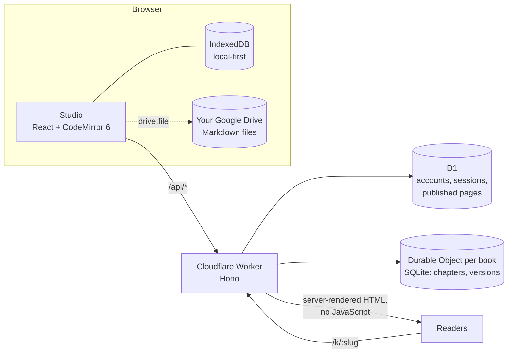

<p align="center">
  <a href="https://publishify.app">
    <picture>
      <source media="(prefers-color-scheme: dark)" srcset=".github/assets/publishify-beyaz.svg">
      
    </picture>
  </a>
</p>

<h3 align="center">The open-source writing studio for authors.</h3>

<p align="center">
  Write anywhere. Keep your files. Publish in one click.
</p>

<p align="center">
  <a href="https://publishify.app/studio/"><strong>Open Studio</strong></a> ·
  <a href="https://publishify.app/en/">Website</a> ·
  <a href="https://publishify.app/en/features/">Features</a> ·
  <a href="https://publishify.app/en/compare/">Compare</a> ·
  <a href="#roadmap">Roadmap</a> ·
  <a href="CONTRIBUTING.md">Contribute</a>
</p>

<p align="center">
  <a href="LICENSE"></a>
  
  
  
</p>

<p align="center">
  
</p>

---

**Publishify** is a free, open-source writing studio for writers of every kind: novelists, short-story writers, poets, essayists, bloggers, students and academics. It runs in any modern browser, on any device, with nothing to install. Each chapter is a plain Markdown file that you own. When a piece is ready, one click turns it into a fast, search-ready web page.

Publishify is a word processor, outliner and publishing tool in one, designed for long-form writing. You plan a book as **parts › chapters › scenes** and write in a quiet editor where Markdown formats itself as you type. Your book can live in your own Google Drive, and you can export it to Word, EPUB, PDF, HTML or Markdown. It was built from day one for languages written in both directions, including Turkish, Kurmanji, Zazaki, Ottoman Turkish and Arabic.

Publishify is released under the [MIT license](LICENSE). Your words are never used for advertising, and nothing in Publishify rewrites your text.

## Contents

- [Why Publishify](#why-publishify)
- [Features](#features)
- [How it compares](#how-it-compares)
- [The editorial board (coming)](#the-editorial-board-coming)
- [Getting started](#getting-started)
- [Architecture](#architecture)
- [Repository layout](#repository-layout)
- [Development](#development)
- [Self-hosting](#self-hosting)
- [Roadmap](#roadmap)
- [Contributing](#contributing) · [Security](#security) · [License](#license)

## Why Publishify

- **Your writing is yours.** Every chapter is a plain `.md` file. Keep the files in your browser, in your own Google Drive, or synced to your account. You can open them with any text editor, today or in twenty years.
- **Works on every device.** Mac, Windows, Linux, Chromebook, iPad and phone all get the same studio in the browser. There is no installer, no licence key and no "this platform is not supported".
- **Free to write.** The editor is free and you can start without an account.
- **From draft to readers in one click.** Publish a blog post, essay, story or whole book as a clean public page with sharing links and structured data that search engines and AI assistants can read.
- **Every script is welcome.** Right-to-left writing, suitable typefaces and correct text direction in every export are built in, not added later.
- **Open, and built to last.** The code is MIT-licensed, the architecture is documented, the code is strictly typed, and the published pages run no JavaScript.

## Features

<table>
<tr>
<td width="50%" valign="top">

### ✍️ Writing
- **Live Markdown.** Markup hides when the cursor leaves the line, so bold, italic, headings, quotes, lists and checklists look the way they will read.
- **Writing mode.** In full screen, menus and panels disappear. The current paragraph stays sharp, the rest fades, and the cursor stays centred (focus and typewriter modes).
- **Dictation.** Speak to write. Say "period", "comma" or "new line" and punctuation is inserted.
- **Word-count goals** to keep you moving.
- **Seven themes:** light, dark, sepia, green, pink, night, and a custom theme built from your own two colours.

</td>
<td width="50%" valign="top">


</td>
</tr>
<tr>
<td valign="top">


</td>
<td valign="top">

### 🗂️ Structure
- **Part › chapter › scene**, with drag-and-drop reordering. A chapter can be turned into a scene and back.
- **15 templates:** novel (three acts, hero's journey), novella, short story, flash fiction, poetry, essay, blog post, memoir, non-fiction, academic article, thesis, picture book and play. A template only sets up structure; it never touches your text.
- **Version history.** Versions are saved as you write, and any of them can be restored.
- **Trash.** Nothing is deleted until you empty the trash yourself.
- **Book-wide search.**

</td>
</tr>
<tr>
<td valign="top">

### 🌍 Languages and scripts
- **Writing languages:** Turkish, Kurmanji (Latin), Zazaki, Ottoman Turkish, Arabic, English, German, French, Russian and Japanese.
- **Right-to-left** editing, with Arabic-script typefaces and correct direction in HTML, EPUB and DOCX.
- **Interface** in eight languages. Translations are welcome; see [Contributing](CONTRIBUTING.md).

</td>
<td valign="top">


</td>
</tr>
<tr>
<td valign="top">


</td>
<td valign="top">

### 🌐 Publishing
- **One-click public pages** at `publishify.app/k/your-address`. A single piece opens as an article; a book gets a table of contents and a page for each chapter.
- **A publication is a copy.** Your draft stays private, and the page changes only when you press *Update*.
- **Fast and safe by design:** pages are rendered on the server with no JavaScript and a strict Content Security Policy. Markdown is sanitised and links are filtered.
- **Search and AI ready:** schema.org metadata (Book, Article, BlogPosting, ScholarlyArticle), canonical URLs and share links that work without scripts.

</td>
</tr>
</table>

### 📦 Your files, your cloud
| Where | What you get |
|---|---|
| **This browser** | Works with no account. Everything is saved locally (IndexedDB). |
| **Your Publishify account** | Passwordless sign-in with a passkey and a one-time recovery code. Chapter-level sync between devices. If two devices edit the same chapter, both versions are kept. |
| **Your Google Drive** *(early access)* | A `Publishify/<Book>/` folder with one Markdown file per chapter, plus `kitap.json`, your cover and narration files. Publishify requests only the `drive.file` scope, so it can see the files it created and nothing else in your Drive. |

### 📤 Export
Markdown, HTML, **Word (.docx)**, **EPUB** (with cover) and **PDF**. Right-to-left direction is kept in every format. You can add a cover to each book and a narration audio file to each chapter.

### 🔐 Privacy and security
- Passkeys (WebAuthn) instead of passwords. Sessions and recovery codes are stored only as SHA-256 hashes.
- Each book lives in its own Durable Object, addressed by `<user>:<book>`. One author's book cannot be reached through another author's account.
- Requests from other origins are rejected for anything that changes data. Account recovery, registration and publishing are rate-limited.
- No advertising and no tracking. Dictation uses your browser's own speech service and is never sent to Publishify.

## How it compares

Publishify is young. Here is where it stands next to two well-loved tools *(as of November 2026)*:

| | **Publishify** | Ulysses | Scrivener |
|---|---|---|---|
| Runs on | Any browser: Mac, Windows, Linux, ChromeOS, iPad, Android, iPhone | Mac, iPad, iPhone | Mac, Windows, iOS |
| Price | **Free** editor | Subscription | One-time purchase |
| Source code | **Open (MIT)** | Closed | Closed |
| Your text is stored as | Plain Markdown, one file per chapter | Library (Markdown-based) | `.scriv` project package |
| Publish to the web | **One-click public pages, built in** | Publishes to blogging platforms | Export only |
| Works fully offline | Not yet ([planned](#roadmap)) | ✓ | ✓ |
| Corkboard / index cards | Not yet | — | ✓ |
| Native desktop and mobile apps | Planned (Tauri) | ✓ | ✓ |

If you love your current tool, keep it. Publishify is for writers who want **free, open, cross-platform tools and their own files**, with a straight path from draft to readers.

## The editorial board (coming)

The next part of Publishify is an **editorial board**: a panel of AI readers and editors that read your manuscript, map its structure (for example the hero's journey), check consistency of names, places and timelines, and show how your revisions progress.

It follows one rule above all: **the board reads, annotates and suggests, but it never rewrites your text.** The final word is always the author's.

The board will be an optional hosted service. It is not part of this repository.

## Getting started

### Use it
Open **[publishify.app/studio](https://publishify.app/studio/)** and start writing. You don't need an account.

### Run it locally
Requirements: **Node.js 22+** and **pnpm** (the version is pinned in `package.json`; `corepack enable` will install it).

```bash
git clone https://github.com/publishify/studio.git
cd studio
pnpm install
pnpm dev            # Studio (editor only) at http://localhost:5173/studio/
```

To run the full stack (accounts, sync and publishing) on your machine:

```bash
pnpm --filter @publishify/api exec wrangler d1 migrations apply publishify --local
pnpm build          # builds Studio and the marketing site into apps/web/dist
pnpm dev:api        # Worker + API + static assets at http://localhost:8787
```

## Architecture



| Layer | Choice | Why |
|---|---|---|
| Editor | [CodeMirror 6](https://codemirror.net/) with a custom live-preview extension | Plain text in the document, fast on very long books, accessible |
| UI | React 19, TypeScript (strict), Tailwind CSS 4, Vite 8 | A large ecosystem; one codebase for web and future native shells |
| Server | [Hono](https://hono.dev/) on Cloudflare Workers | Runs close to every reader, with almost no cold start |
| Data | D1 (accounts, publications) and one SQLite-backed Durable Object per book | Strong isolation between books and simple, consistent revision-based sync |
| Auth | Passkeys via [SimpleWebAuthn](https://simplewebauthn.dev/) | No passwords to leak |
| Validation | [Valibot](https://valibot.dev/) | Small, typed schemas at every API boundary |
| Markdown | [marked](https://marked.js.org/) with a sanitising renderer | Safe publishing of author content on our domain |
| Marketing site | Static HTML generated from a single content file, with no JavaScript | Instant pages; the same data feeds `llms.txt` and the sitemap |

**Sync model.** The unit of sync is the chapter. Every chapter has a server sequence number, and the client sends the number it last saw. If they differ, the server version is kept and the client's text becomes a separate *conflicted copy*. **Publishify never silently overwrites text.** Deletes are kept as tombstones. CRDTs are deliberately postponed, because one author with several devices does not need them.

## Repository layout

```
apps/
  web/            Studio, the writing editor (React + CodeMirror 6), served at /studio/
  site/           Marketing site: static HTML, SEO/GEO, llms.txt (TR + EN)
workers/
  api/            Cloudflare Worker: auth, sync, publishing, public pages
    src/            index.ts (routes), auth.ts (passkeys), book-do.ts (Durable Object), render.ts (safe HTML)
    migrations/     D1 schema
```

## Development

| Command | What it does |
|---|---|
| `pnpm dev` | Studio dev server with hot reload |
| `pnpm dev:api` | Worker locally (`wrangler dev`) |
| `pnpm build` | Type-check and build Studio and the site |
| `pnpm test` | Unit tests (Vitest) for Studio and the API |

Code comments, tests, scripts and architecture decision records are written in **English**. Product text (the interface and the marketing site) is available in several languages.

## Self-hosting

Publishify runs on a single Cloudflare Worker. To deploy your own copy:

1. Create a D1 database and put its ID in `workers/api/wrangler.jsonc`. Replace the `routes` entry with your own domain.
2. Add your hostname to `ALLOWED_HOSTS` in `workers/api/src/auth.ts`. Passkeys are bound to a domain.
3. *(Optional)* Create a Google OAuth client and set `GOOGLE_CLIENT_ID` in `apps/web/src/drive.ts` for the Drive connection.
4. Apply migrations and deploy:
   ```bash
   cd workers/api
   pnpm exec wrangler d1 migrations apply publishify --remote
   pnpm deploy
   ```

The free Cloudflare plan is enough for personal use.

## Roadmap

- [x] Live-Markdown editor, focus and typewriter modes, themes
- [x] Part › chapter › scene, templates, version history, trash
- [x] Passkey accounts and chapter-level sync
- [x] Your own Google Drive as storage *(early access)*
- [x] Export to DOCX, EPUB, PDF, HTML and Markdown
- [x] One-click publishing with server-rendered pages
- [x] Right-to-left scripts and multilingual interface
- [ ] Import an existing manuscript (`.docx`, `.md`, `.txt`, Scrivener)
- [ ] Full offline support (PWA)
- [ ] Book-wide find and replace, footnotes, images and tables
- [ ] Author pages, RSS, custom domains for publications
- [ ] Desktop and mobile apps (Tauri 2), iCloud Drive
- [ ] Text analysis in Rust → WebAssembly: repetition, dialogue ratio, name consistency
- [ ] The editorial board (hosted, optional)

## Contributing

Bug reports, translations, documentation and code are all welcome. Please read **[CONTRIBUTING.md](CONTRIBUTING.md)** first. Good first steps include translating the interface into your language, reviewing existing translations, and adding tests.

## Security

Please **do not open public issues for security problems.** See **[SECURITY.md](SECURITY.md)** for how to report them privately.

## License

[MIT](LICENSE) © The Publishify Authors.

The license covers the code, not the brand: the **Publishify** name and logo are not licensed for reuse. If you fork the project, please give your fork a different name and logo.

<p align="center"><sub>Built with care for people who write.</sub></p>
